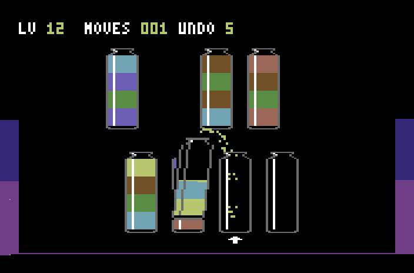

# Liquid Logic — Commodore 64

Παζλ ταξινόμησης χρωματιστών υγρών σε μπουκάλια για **Commodore 64** (PAL),
γραμμένο σε 6502 assembly. Μεταφορά του
[Liquid Logic για Amstrad CPC](../LiquidLogicCPC): ίδιοι κανόνες, ίδιες 100
πίστες, ίδια φυσική του πίδακα, ίδια «Χαλάρωση» με seed (το ίδιο seed δίνει
τις ίδιες πίστες και στους δύο υπολογιστές).

Μεταγγίζεις υγρά από μπουκάλι σε μπουκάλι ώσπου κάθε μπουκάλι να περιέχει ένα
μόνο χρώμα. Το μπουκάλι πετάει δίπλα στον στόχο, γέρνει, και το υγρό ρέει σαν
αληθινός πίδακας: σωματίδια με βαρύτητα που διαγράφουν τόξο, πιτσιλίζουν στην
επιφάνεια και ανεβάζουν τη στάθμη γραμμή-γραμμή.



## Πώς παίζεται

Από τον τίτλο, SPACE για την επιλογή πίστας, ή R για τη **«Χαλάρωση»**:
ατέλειωτες τυχαίες πίστες, χωρίς αστέρια και χρόνο. D για «Χαλάρωση» με
**seed** (4 ψηφία), O για τις **επιλογές** (μουσική, εφέ, ταχύτητα, πλήκτρα,
θέμα), H για τις **οδηγίες**, S για τα **στατιστικά** και τα 12
**μετάλλια**. Κάθε ειδικός τύπος εξηγείται με μια κάρτα την πρώτη φορά, και
μετά την πίστα 100 υπάρχει γιορτή και ένα δεύτερο θέμα χρωμάτων (NEON).
Ξεκινάς από την 1· κάθε πίστα που λύνεις ξεκλειδώνει την επόμενη και κερδίζει
ως 3 αστέρια, ανάλογα με το πόσο κοντά στις ελάχιστες κινήσεις (par) την
έλυσες.

| Πλήκτρο | |
|---|---|
| CRSR / I J K L / joystick (θύρα 2) | κέρσορας (SHIFT + CRSR: αριστερά, πάνω) |
| SPACE / fire | επιλογή πηγής, μετά στόχου |
| RUN/STOP ή ← | ακύρωση επιλογής· χωρίς επιλογή: παύση |
| M | στη νίκη ή στην παύση: επιλογή πίστας |
| U | undo (5 ανά πίστα) |
| R | restart πίστας· στον τίτλο: «Χαλάρωση» |
| E | έξτρα άδειο μπουκάλι (μία φορά, όπου το HUD δείχνει `E+`) |

Τύποι πιστών (κρυμμένες στρώσεις, πάγος, λουκέτο, όριο κινήσεων, ψηλά
μπουκάλια, μικτές χωρητικότητες, σταγονόμετρο, κουρτίνα, χρονόμετρο) και όλα
τα υπόλοιπα στο εγχειρίδιο: [ελληνικά](docs/manual-el.md)
([PDF](docs/manual-el.pdf)), [English](docs/manual-en.md)
([PDF](docs/manual-en.pdf)).

## Build

Απαιτούνται:

- [64tass](https://sourceforge.net/projects/tass64/) (≥ 1.58)
- `c1541` και `x64sc` από το [VICE](https://vice-emu.sourceforge.io/) (≥ 3.6)
- Python 3 (με Pillow για τις εικόνες) — γραφικά, ήχος, πίστες, tests

```bash
make
```

Βγάζει το `build/liquidlogic.d64` (και το `build/liquidlogic.prg`). Στον C64
ή σε emulator:

```
LOAD"LIQUID",8,1
RUN
```

Άλλοι στόχοι:

```bash
make run      # x64sc με τη δισκέτα
make assets   # ξαναπαράγει γραφικά, ήχο, πίνακες φυσικής και πίστες (assets/data)
make test     # headless VICE: λύνει και τις 100 πίστες, ελέγχει ειδικούς τύπους, οθόνες, «Χαλάρωση», δισκέτα
make shot     # headless VICE: εικόνες όλων των οθονών στο build/shots
make manual   # εικόνες στο docs/imgs και τα PDF των εγχειριδίων (LibreOffice)
make video    # βίντεο 4 λεπτών με ήχο -> build/liquidlogic.mp4 (ffmpeg)
make clean
```

## Δομή

```
src/          6502 πηγαίος κώδικας (main, hw, screen, bottles, sprites, particles, pour, ...)
assets/src/   Python που παράγει γραφικά (make_gfx.py) και ήχο (make_sound.py)
assets/data/  παραγόμενα δεδομένα για το 64tass (και levels.json για τα tests)
tools/        γεννήτρια πιστών με solver, headless test μέσα από το binary monitor του VICE, εγχειρίδιο
docs/         εγχειρίδιο (manual-el/en .md και .pdf, εικόνες στο imgs/)
plan.md       αρχιτεκτονική, χάρτης μνήμης, διαφορές από τον CPC
```

## Κατάσταση

Όλο το παιχνίδι του CPC (ορόσημα M0–M10) είναι μεταφερμένο: 100 πίστες,
ειδικοί τύποι, πίδακας 64 σωματιδίων, πτήση και γέρσιμο του μπουκαλιού,
διαβάθμιση στο border, ήχος SID, αποθήκευση προόδου στη δισκέτα,
«Χαλάρωση» (και με seed), επιλογές, οδηγίες και κάρτες, στατιστικά και
μετάλλια, τέλος. Ελεγμένο στον headless VICE (x64sc, με αληθινό 1541 για την
αποθήκευση)· όχι ακόμα σε πραγματικό C64. Λεπτομέρειες και γνωστά όρια στο
[plan.md](plan.md).
