# Liquid Logic — Εγχειρίδιο

*Παζλ ταξινόμησης υγρών για Commodore 64*

## Φόρτωμα

Βάλε τη δισκέτα στο drive 8 και γράψε:

```
LOAD"LIQUID",8,1
RUN
```

Το παιχνίδι είναι ένα αρχείο 124 blocks· με το κανονικό KERNAL του C64 το
φόρτωμα κρατάει περίπου ενάμισι λεπτό (λιγότερο με fastloader, π.χ. JiffyDOS
ή cartridge). Δουλεύει σε PAL C64.

Η πρόοδός σου (ξεκλείδωτες πίστες και αστέρια, επιλογές, στατιστικά,
μετάλλια, το seed σου) γράφεται στη δισκέτα, στο αρχείο `LIQUID.SAV`, όταν
φεύγεις από την οθόνη νίκης, από τις επιλογές ή από τα στατιστικά και κάτι
έχει αλλάξει (το HUD γράφει `SAVING...` για λίγα δευτερόλεπτα), και
φορτώνεται στην επόμενη εκκίνηση. Γράφεται στο ίδιο drive από το οποίο
φορτώθηκε το παιχνίδι. Η δισκέτα δεν πρέπει να είναι προστατευμένη από
εγγραφή· αν είναι, ή αν λείπει, το παιχνίδι παίζεται κανονικά, απλώς η
πρόοδος δεν κρατιέται.

## Ο στόχος

Κάθε μπουκάλι έχει στρώσεις χρωματιστού υγρού. Μετάγγισε από μπουκάλι σε
μπουκάλι ώσπου κάθε μπουκάλι να έχει **ένα μόνο χρώμα** (ή να είναι άδειο).
Ένα γεμάτο μονόχρωμο μπουκάλι κλείνει με φελλό.

Μια μετάγγιση επιτρέπεται όταν το μπουκάλι-στόχος έχει χώρο και είναι άδειο ή
έχει επάνω **το ίδιο χρώμα**. Μεταφέρεται όλη η επάνω στρώση του ίδιου
χρώματος, όσο χωράει. Μια άκυρη κίνηση ακούγεται ως βουητό και το μπουκάλι
χοροπηδάει.

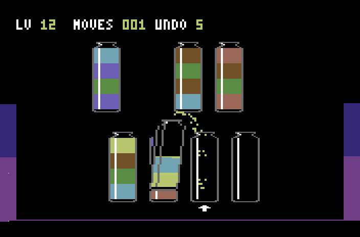

*Μια μετάγγιση: το μπουκάλι πετάει δίπλα στον στόχο, γέρνει, και ο πίδακας γεμίζει τον στόχο*

## Χειρισμός

Παίζεται με το πληκτρολόγιο ή με joystick στη **θύρα 2**.

| Πλήκτρο | Ενέργεια |
|---|---|
| CRSR / I J K L / joystick | κέρσορας: αριστερά-δεξιά στη σειρά, πάνω-κάτω αλλάζει σειρά (με SHIFT τα CRSR πάνε αριστερά και πάνω) |
| SPACE / fire | 1η φορά: το μπουκάλι **από το οποίο** αδειάζει (σηκώνεται)· 2η φορά: το μπουκάλι **στο οποίο** γεμίζει (το πρώτο πετάει δίπλα του, γέρνει και αδειάζει) |
| SPACE στο ίδιο / RUN/STOP | ακύρωση της επιλογής |
| RUN/STOP (χωρίς επιλογή) | παύση: RUN/STOP συνέχεια, R από την αρχή, M μενού |
| U | undo (5 ανά πίστα) |
| R | η πίστα από την αρχή |
| E | ένα έξτρα άδειο μπουκάλι, μία φορά, όπου το HUD δείχνει `E+` |
| M | στη νίκη, στην παύση, στο τέλος του χρόνου: επιλογή πίστας |

Το **←** (πάνω αριστερά στο πληκτρολόγιο) κάνει ό,τι και το RUN/STOP. Τα
I J K L και SPACE αλλάζουν από τις επιλογές.

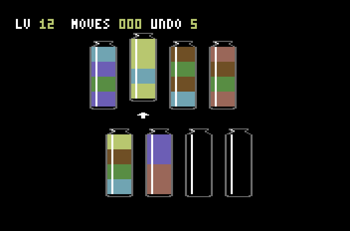

*Επιλεγμένη πηγή: σηκώνεται, και ο κέρσορας πάει στον στόχο*

## Οθόνες

- **Τίτλος** — SPACE για την επιλογή πίστας, R για τη «Χαλάρωση», D για
  «Χαλάρωση» με seed, O για τις επιλογές, H για τις οδηγίες, S για τα
  στατιστικά.
- **Επιλογές** (O) — πάνω-κάτω διαλέγεις, SPACE ή αριστερά-δεξιά αλλάζεις,
  RUN/STOP πίσω. `MUSIC`/`SOUND FX` on/off, `SPEED` `NORMAL` ή `FAST` (πιο
  γρήγορη πτήση του μπουκαλιού), `THEME` `CLASSIC` ή `NEON` (ξεκλειδώνει μετά
  την πίστα 100), `KEYS` `REDEFINE`: πάτα με τη σειρά τα πλήκτρα για
  αριστερά, δεξιά, πάνω, κάτω και fire (όχι RUN/STOP ή ←). Τα CRSR και το
  joystick δουλεύουν πάντα.
- **Οδηγίες** (H) — 4 σελίδες: SPACE ή δεξιά επόμενη, αριστερά προηγούμενη,
  RUN/STOP πίσω.
- **Κάρτες** — την πρώτη φορά που μια πίστα έχει έναν ειδικό τύπο (πάγο,
  λουκέτο κτλ.), μια κάρτα τον εξηγεί με ένα παράδειγμα πριν ξεκινήσει η
  πίστα (SPACE για συνέχεια· ο χρόνος δεν τρέχει).
- **Στατιστικά** (S) — λυμένες πίστες, αστέρια, τέλειες πίστες (3 αστέρια),
  μεταγγίσεις, πίστες «Χαλάρωσης», και τα 12 μετάλλια: κίτρινα όσα έχεις,
  γκρι τα υπόλοιπα. Με τον κέρσορα διαλέγεις ένα και βλέπεις από κάτω τι
  χρειάζεται.
- **Επιλογή πίστας** — 100 κελιά. Γκρι: κλειδωμένες. Λευκές: διαθέσιμες.
  Κίτρινες: λυμένες, με τα αστέρια τους από κάτω. Κέρσορας και SPACE·
  RUN/STOP πίσω στον τίτλο.
- **Πίστα** — επάνω το HUD: `LV` πίστα, `MOVES` κινήσεις (ή `LEFT` όσες
  μένουν), `UNDO` όσα undo μένουν, `TIME` ο χρόνος, `E+` το έξτρα μπουκάλι.

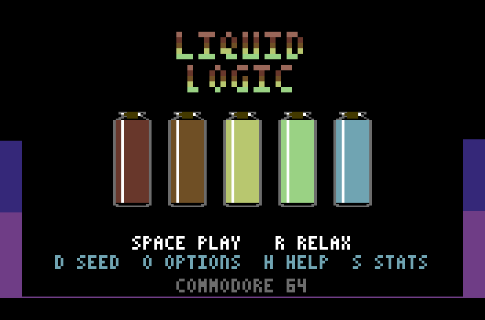

*Ο τίτλος*

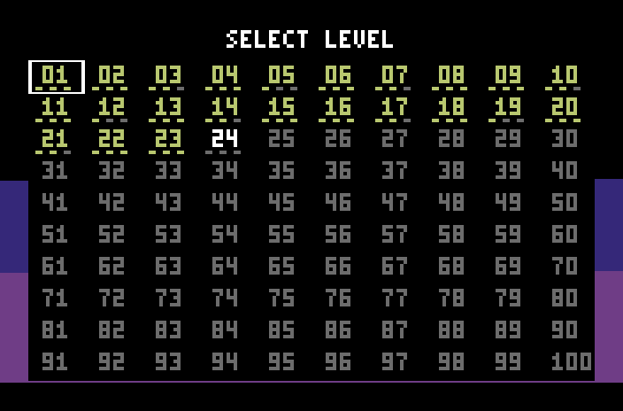

*Επιλογή πίστας: οι λυμένες σε κίτρινο, με τα αστέρια τους*

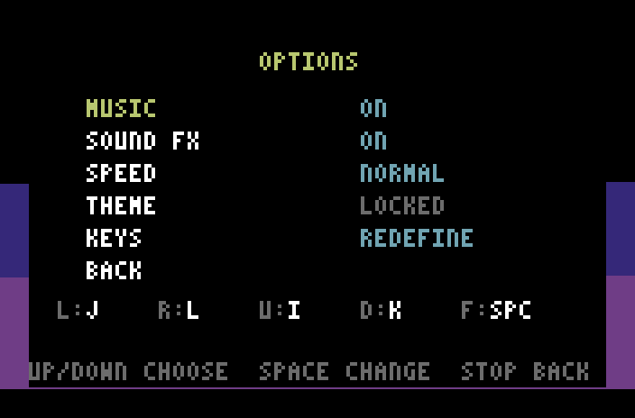

*Επιλογές*

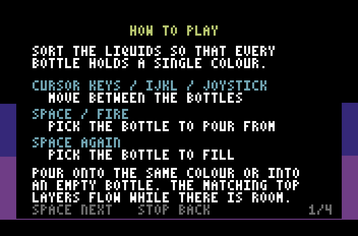

*Οδηγίες, σελίδα 1*

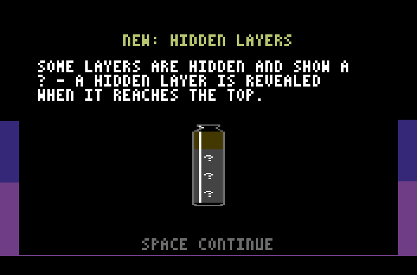

*Κάρτα για έναν νέο ειδικό τύπο*

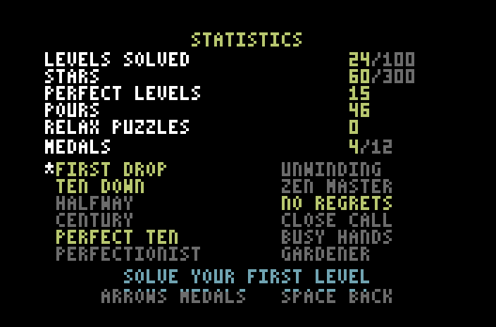

*Στατιστικά και μετάλλια*

## Αστέρια

Κάθε πίστα έχει ένα **par**: τις λιγότερες κινήσεις που βρήκε ο υπολογιστής.

| Αστέρια | Κινήσεις |
|---|---|
| ★★★ | ως το par |
| ★★ | ως par + par/4 + 1 |
| ★ | περισσότερες |

Κρατιέται το καλύτερο αποτέλεσμα κάθε πίστας. Κάθε λυμένη πίστα ξεκλειδώνει
την επόμενη.

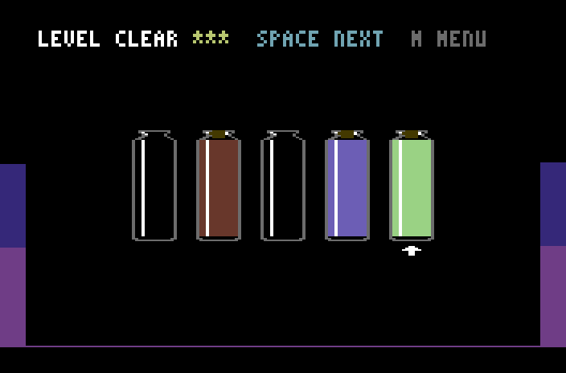

*Νίκη: τα αστέρια, και τι κάνουν τα SPACE και M*

## Ειδικά μπουκάλια και πίστες

| Τι βλέπεις | Τι σημαίνει |
|---|---|
| Σκούρο γκρι με «?» | **κρυμμένη στρώση**: αποκαλύπτεται όταν βρεθεί στην κορυφή. Η μετάγγιση σταματάει πάνω της, ακόμα κι αν έχει το ίδιο χρώμα |
| Λευκοί κρύσταλλοι και αριθμός | **πάγος**: ούτε αδειάζει ούτε γεμίζει. Ο αριθμός μειώνεται με κάθε κίνηση· στο 0 ξεπαγώνει |
| Λουκέτο σε ένα χρώμα | **κλειδωμένο**: ανοίγει όταν ολοκληρωθεί κάποιο μπουκάλι με αυτό το χρώμα |
| Λευκός βολβός στον λαιμό | **σταγονόμετρο**: από αυτό μεταγγίζεται μία στρώση τη φορά |
| Ρίγες σε όλο το σώμα | **κουρτίνα**: δεν βλέπεις τι έχει, ως την πρώτη μετάγγιση σε αυτό ή από αυτό |
| Εγκοπές στους τοίχους | **άλλο μέγεθος**: χωράει λιγότερες στρώσεις (μία εγκοπή ανά όριο στρώσης) |
| Λεπτότερες στρώσεις | **ψηλό μπουκάλι**: 5 ή 6 στρώσεις |
| `LEFT n` στο HUD | **όριο κινήσεων**: στο 0 χωρίς λύση, U ή R |
| `TIME n` στο HUD | **χρονόμετρο**: στο 0, R για ξανά |

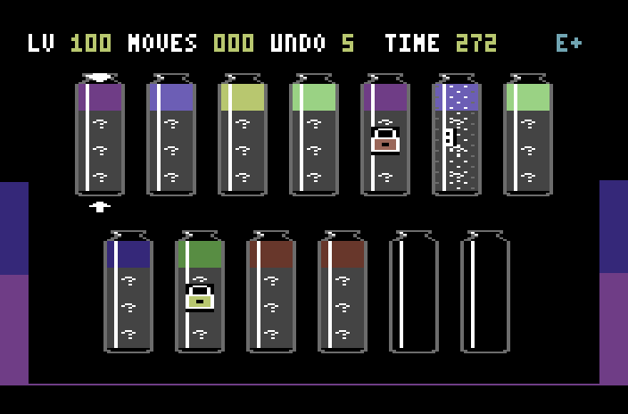

*Πίστα 100: πάγος, λουκέτα, σταγονόμετρο, κρυμμένες στρώσεις, χρονόμετρο και E+*

Κάθε 10η πίστα είναι **Πρόκληση**: πολλοί τύποι μαζί και ένα χρώμα παραπάνω.

## Χαλάρωση

Από τον τίτλο, **R**. Ατέλειωτες τυχαίες πίστες: 5 ως 8 χρώματα, 4 στρώσεις,
δύο άδεια μπουκάλια και το έξτρα (E), χωρίς ειδικά μπουκάλια, χρόνο, αστέρια
ή αποθήκευση. Το HUD γράφει `RELAX`.

| Πλήκτρο | Ενέργεια |
|---|---|
| SPACE στη νίκη | επόμενη τυχαία πίστα |
| R | η ίδια πίστα από την αρχή |
| RUN/STOP, μετά SPACE | παύση και άλλη πίστα (αν αυτή δεν σου αρέσει) |
| M / RUN/STOP στη νίκη | πίσω στον τίτλο |

Σχεδόν όλες λύνονται· αν κολλήσεις, U, E ή άλλη πίστα.

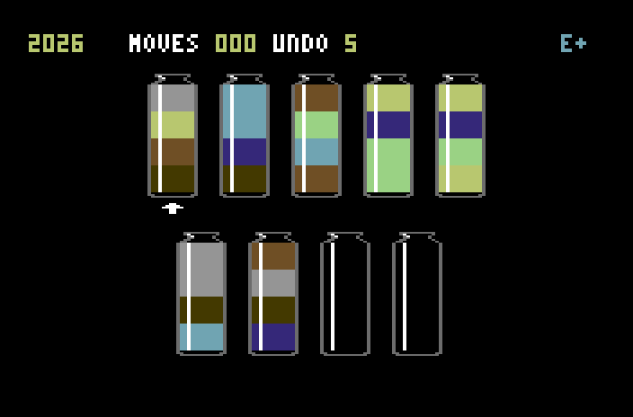

*«Χαλάρωση» με seed: το HUD δείχνει το seed*

### Με seed

Από τον τίτλο, **D**. Γράψε 4 ψηφία (DEL σβήνει) και SPACE ή RETURN. Το ίδιο
seed δίνει τις ίδιες πίστες, με την ίδια σειρά, σε κάθε C64 — **και στο
Liquid Logic του Amstrad CPC**: πες το seed σε έναν φίλο και παίξτε τις ίδιες.
Το HUD γράφει το seed, και η νίκη ποια πίστα του seed έλυσες (π.χ. `2026-3`).

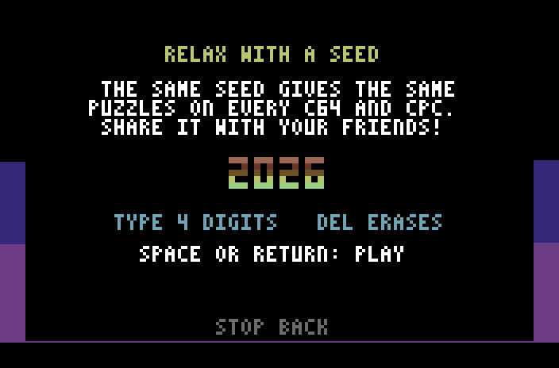

*Η οθόνη του seed*

## Μετάλλια

| Μετάλλιο | Πώς |
|---|---|
| FIRST DROP | η πρώτη λυμένη πίστα |
| TEN DOWN / HALFWAY / CENTURY | 10 / 50 / 100 λυμένες πίστες |
| PERFECT TEN / PERFECTIONIST | 3 αστέρια σε 10 / σε όλες τις πίστες |
| UNWINDING / ZEN MASTER | 10 / 100 πίστες «Χαλάρωσης» |
| NO REGRETS | πίστα από την 30 και μετά χωρίς κανένα undo |
| CLOSE CALL | πίστα με χρονόμετρο, με 10 δευτερόλεπτα ή λιγότερα |
| BUSY HANDS | 1000 μεταγγίσεις |
| GARDENER | μια πίστα με seed |

Όταν κερδίζεις ένα, η γραμμή της νίκης εναλλάσσεται με `MEDAL: ...`.

## Το τέλος

Λύσε και την πίστα 100 και πάτα SPACE: σε περιμένει μια γιορτή, και
ξεκλειδώνει το θέμα **NEON** (μαύρο border χωρίς διαβάθμιση, ροζ γυαλί) στις
επιλογές.

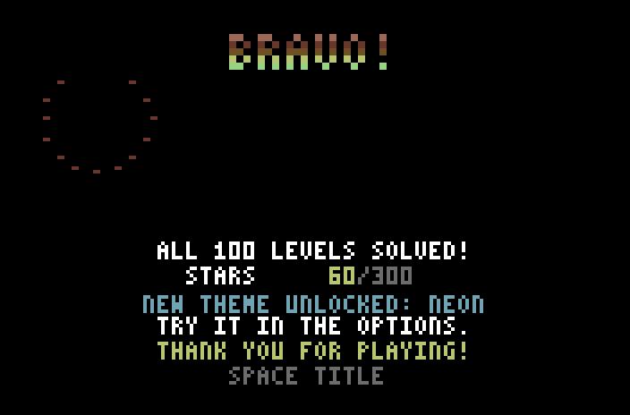

*Το τέλος, μετά την πίστα 100*

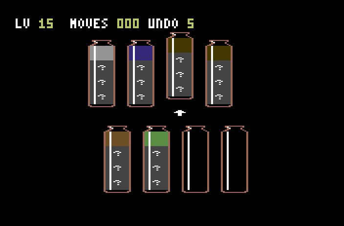

*Το θέμα NEON*

## Αν κολλήσεις

Όταν δεν υπάρχει καμία έγκυρη κίνηση, το HUD γράφει `NO MOVES!`. Πάτα **U** για
να γυρίσεις πίσω, **R** για να ξεκινήσεις από την αρχή, ή **E** για έξτρα
μπουκάλι όπου επιτρέπεται.

Συμβουλές:

- Κράτα ένα μπουκάλι άδειο όσο γίνεται.
- Μάζευε πρώτα τα χρώματα που είναι ήδη στην κορυφή πολλών μπουκαλιών.
- Στις κρυμμένες στρώσεις, άνοιξε πρώτα τα μπουκάλια με τις λιγότερες «?».
